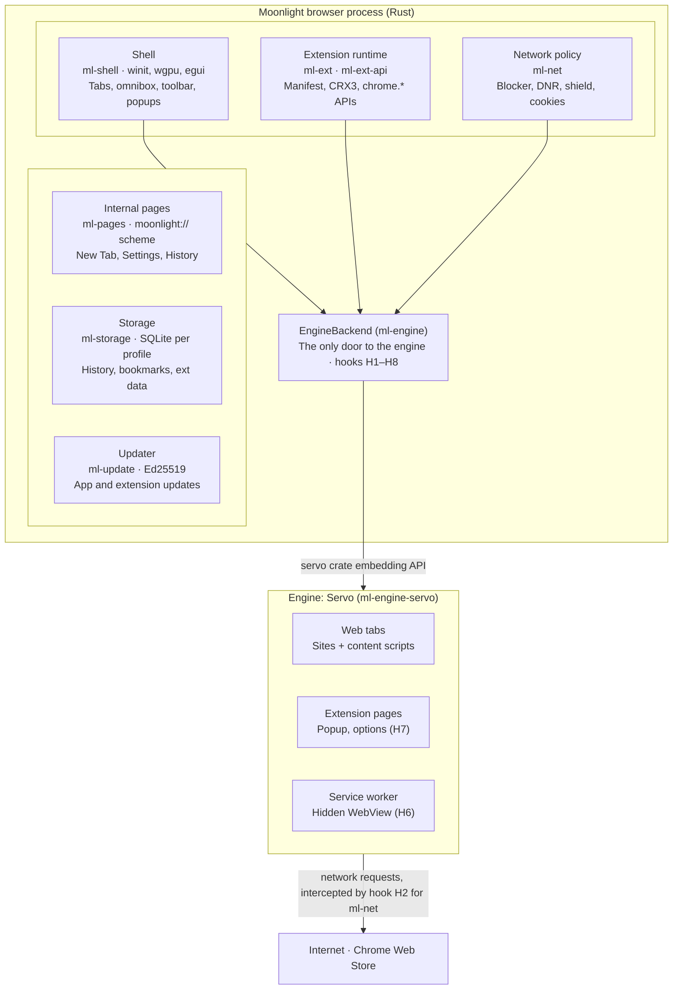

# Moonlight — Technical Architecture

Last updated: 2026-11-23

Related documents: [Product Requirements](01-product-requirements.md)

## ADR-001: Rendering engine

**Decision: Servo as the main engine, wrapped behind an `EngineBackend` trait; the criteria below are validated at the end of Phase 0 (4-week spike).** Status: Accepted, 23 November 2026. Main reason: Moonlight must be native Rust and lightweight.

**Context.** Building an HTML/CSS/JS engine from scratch is not realistic for a small team. The Moonlight designs already assume a light engine that is not perfect yet: there is an "unsupported by the Moonlight engine" banner, extension compatibility labels, and 96 MB of RAM on the New Tab page. That profile fits Servo, not Chromium.

| Criterion | A. Servo (Rust) | B. Chromium via CEF (`cef-rs`) | C. System WebView (wry) |
| --- | --- | --- | --- |
| Engine language | Rust + SpiderMonkey (C++) for JS | C++, wrapped in Rust | Depends on the OS |
| Web compatibility | Still growing; monthly releases | On par with Chrome | Differs per OS |
| Memory footprint | Low, fits the design target | High | Medium |
| Chrome extensions | Built in-house on top of engine hooks | Alloy style (custom UI) does not support the extension API; still has to be built in-house | Practically impossible |
| Full control of the UI | Yes, through the embedding API | Yes, through Alloy style | Limited |
| Distribution size | Small to medium | Large (hundreds of MB installed) | Small |
| Fit with the design and the "Rust browser" identity | High | Medium | Low |

**Why Servo.** Servo 0.1.0 can now be added with `cargo add servo` and provides `ServoBuilder` and `WebView`. The project is active: the January 2026 release added multi-window support, and the embedding API keeps expanding every month.

**Why not CEF from the start.** CEF gives full web compatibility, but for a custom UI Moonlight would have to use Alloy style, and the extension API tests are marked unsupported in that style. The extension layer would still have to be built in-house, much like Electron, which only supports part of the extension API. Its memory cost also contradicts the product promise.

**Validation criteria at the end of Phase 0** (targets Servo must reach):

1. ≥ 70% of the 50 test sites pass the smoke test.
2. Hooks H1–H6 (see the Components section) exist or can be added within ≤ 6 weeks of work.
3. The prototype loads a "hello world" MV3 extension with a popup, `storage`, and a content script.
4. RAM for 1 New Tab ≤ 150 MB.

**If validation fails:** use a CEF backend through the same trait, accept higher RAM use, and update the product promises in the PRD.

**Consequences:** some heavy sites will not work in 1.0; Moonlight must show the compatibility banner and contribute to Servo upstream.

## Architecture diagram



The shell, extension runtime, and network policy only talk to the engine through `EngineBackend`; replacing Servo with another backend means rewriting `ml-engine-servo` only.

## Components, process model, and engine hooks

Moonlight is one browser process that owns the UI, data, extra networking, and the extension runtime, plus the engine that renders web content; everything that touches the engine goes through the `EngineBackend` trait.

**Main components**

| Component | Responsibility | Technology |
| --- | --- | --- |
| Shell (browser chrome) | Window, tab strip, omnibox, toolbar, menus, popovers | `winit` + `wgpu` + `egui` (same pattern as servoshell) |
| Engine adapter | Creates and manages WebViews, forwards input, receives navigation events | `servo` crate, behind the `EngineBackend` trait |
| Internal pages | `moonlight://newtab`, `settings`, `extensions`, `history`, `downloads` | HTML/CSS/TS, served through the `moonlight://` scheme and rendered by the engine |
| Extension runtime | Manifest, permissions, service worker, content scripts, `chrome.*` APIs | Rust; a thin JS shim on the page side |
| Network policy | Built-in tracker blocker (global + per-site toggle), declarativeNetRequest, shield counter, third-party cookies, HTTPS-only | Rust, attached to the request interception hook |
| Storage | Profile, history, bookmarks, settings, extension storage | SQLite (`rusqlite`), one folder per profile |
| Updater | Check, download, verify, and install app and extension updates | Rust, Ed25519 signatures |

**Process model**

- **Alpha:** a single process; the engine runs on its own thread. A content crash can take down the app, which is acceptable for Alpha.
- **Beta/1.0:** web content in separate processes, using the engine's multiprocess mode once it is stable; extension service workers run in hidden WebViews that shut down after 30 seconds idle, mirroring the MV3 lifecycle.

**Hooks needed from the engine** (each verified in the Phase 0 spike):

| ID | Hook | Used for |
| --- | --- | --- |
| H1 | Custom scheme handler (`moonlight://`, `chrome-extension://`) | Internal pages, extension files |
| H2 | Request interception: block, redirect, modify headers | declarativeNetRequest, built-in blocker, shield, cookies |
| H3 | Script injection at `document_start` / `document_end` / `document_idle` | Content scripts |
| H4 | Isolated world (extension JS separated from page JS) | Content script security |
| H5 | JS ↔ Rust bridge with async responses | All `chrome.*` APIs |
| H6 | Hidden / offscreen WebView | Background service worker, `offscreen` |
| H7 | Popup WebView that sizes itself to its content | Extension popups |
| H8 | Report of web APIs that were called but are unsupported | Compatibility banner |

Hooks Servo does not have yet are proposed as upstream contributions, not patched in a fork, so monthly upgrades stay cheap.

## Cargo workspace structure and dependencies

One repo, one Cargo workspace, small crates prefixed `ml-` so module boundaries are clear and incremental builds stay fast. Only `ml-engine-servo` may depend on the `servo` crate.

```text
moonlight/
├─ Cargo.toml              # [workspace], dependency versions pinned here
├─ rust-toolchain.toml     # Rust version pinned
├─ AGENTS.md               # project conventions for AI coding sessions
├─ crates/
│  ├─ moonlight/           # binary: main(), wiring, CLI flags
│  ├─ ml-shell/            # window, tab strip, omnibox, toolbar (egui)
│  ├─ ml-engine/           # EngineBackend trait + neutral event types
│  ├─ ml-engine-servo/     # EngineBackend implementation on top of servo
│  ├─ ml-net/              # built-in blocker, declarativeNetRequest, shield, cookie policy
│  ├─ ml-ext/              # manifest, CRX3, permissions, extension lifecycle
│  ├─ ml-ext-api/          # chrome.* implementations per namespace
│  ├─ ml-storage/          # profile, SQLite, schema migrations
│  ├─ ml-pages/            # moonlight:// assets (built HTML/CSS/TS)
│  ├─ ml-i18n/             # Fluent, en-US strings
│  └─ ml-update/           # app + extension updater
├─ web/                    # TypeScript sources for internal pages + chrome.* shim
├─ tests/
│  ├─ sites/               # list of 50 test sites + scenarios
│  └─ extensions/          # test extensions + scenarios
├─ fuzz/                   # cargo-fuzz: manifest, CRX, DNR rules
├─ xtask/                  # cargo xtask: build web, bundle, release
└─ docs/                   # these documents + docs/adr/
```

| Need | Crate | Notes |
| --- | --- | --- |
| Engine | `servo` | Pinned version; scheduled monthly upgrades |
| Windowing & input | `winit` | |
| UI rendering | `wgpu`, `egui` | Follow the versions servoshell uses for compatibility |
| Async | `tokio` | Runtime for networking, storage, extensions |
| Serialization | `serde`, `serde_json` | manifest.json, extension messages |
| Database | `rusqlite` (bundled) | |
| Tracker blocker | `adblock` | adblock-rust from Brave, MPL-2.0; EasyList + EasyPrivacy filters |
| URLs & patterns | `url`, `regex`, `globset` | Host match patterns, DNR `urlFilter`/`regexFilter` |
| CRX3 | `prost`, `zip`, `rsa`, `p256`, `sha2` | CRX3 header is protobuf |
| Localization | `fluent-bundle` | |
| Secrets | `keyring` | Profile encryption key in the OS keychain |
| Logging | `tracing`, `tracing-subscriber` | |
| Errors | `thiserror` (libraries), `anyhow` (binary) | |
| Testing | `cargo-nextest`, `insta`, `proptest`, `cargo-fuzz` | |

## Security, sandboxing, and data storage

All extension permissions are enforced in Rust, not in the JS shim, because a page can tamper with the shim; Moonlight's process sandboxing is weaker than Chromium's and must be stated openly.

**Security principles**

- Every `chrome.*` call carries an extension ID filled in on the Rust side; permissions and host permissions are checked before execution.
- Hook H4 (isolated world) is a hard requirement to close F2. During F2 development, main-world injection may exist only behind an explicit developer flag for testing; it must never be enabled in an Alpha release. Content scripts must not run in the page's main world in production; extensions that need content scripts are labeled Partial until H4 exists.
- `moonlight://` pages can only call internal APIs through an allowlist; normal web pages cannot call them.
- .crx packages are verified (CRX3 signature, ID derived from the public key) before unpacking; unpacking rejects path traversal (`../`).
- App updates are signed with Ed25519; the private key lives in an HSM or a CI secret, never in the repo.
- The threat model is written in `docs/security/threat-model.md` before Beta; external security audit before 1.0.

**Profile folder layout**

```text
<data-dir>/Moonlight/Profiles/Default/
├─ moonlight.db         # history, bookmarks, settings, site permissions, New Tab stats
├─ downloads.db
├─ cookies/             # managed by the engine
├─ extensions/<id>/<version>/   # unpacked, read-only
└─ extension-storage/<id>.db    # chrome.storage.local / sync / session
```

`<data-dir>` follows OS conventions (`%LOCALAPPDATA%` on Windows, `$XDG_DATA_HOME` on Linux) through the `directories` crate. Private windows use a temporary in-memory profile that is deleted when the window closes. SQLite schema migrations are numbered and tested in CI.

## Sources

- [Servo 0.1.0 on crates.io (Simon Willison)](https://simonwillison.net/2026/Apr/13/servo-crate-exploration/)
- [Servo 0.0.4: multi-window support (Phoronix)](https://phoronix.com/news/servo-0.0.4)
- [Servo Book: embedding](https://book.servo.org/embedding/overview.html)
- [CEF announcement: Alloy style and Chrome bootstrap](https://groups.google.com/g/cef-announce/c/s1WaovAopFo)
- [CEF commit: ExtensionTest unsupported in Alloy style](https://gitea.it/bcarrella/cef/src/commit/dca0435d2f16c2b80861bae62ce7746a1b6113ea)
- [cef-rs (tauri-apps)](https://github.com/tauri-apps/cef-rs)
- [Chrome Extension Support in Electron](https://electronjs.org/docs/api/extensions)
- [adblock crate (lib.rs)](https://lib.rs/crates/adblock)
