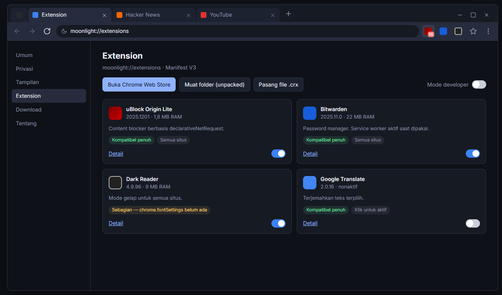
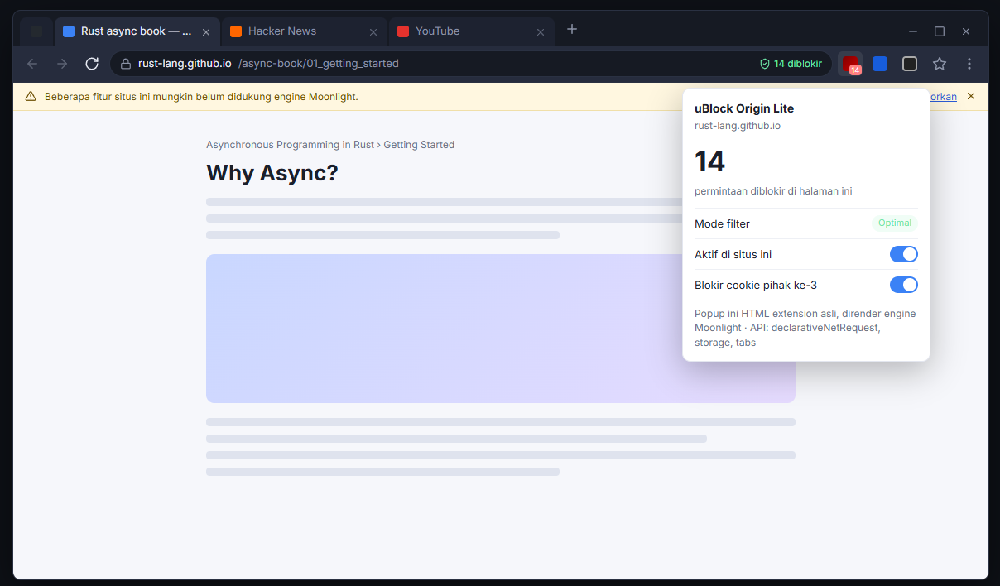

# Moonlight — Design & UI Spec

Last updated: 2026-11-23

Related documents: [Product Requirements](01-product-requirements.md)

## Design principles

The Moonlight mockups show a browser that is dark, calm, and open about what happens inside it; the four principles below guide every screen that is not designed yet.

1. **Content first.** The browser chrome is dark and low-contrast so the web page stays the focus.
2. **Show, don't hide.** Real numbers (requests blocked, RAM, versions, package size) appear where the user makes decisions.
3. **Honest about limits.** The Partial status and the yellow banner name what is missing instead of a generic message.
4. **One action color.** Periwinkle blue for primary actions, bright blue for active states; other colors only for status (green, orange, red, yellow).

Identity: a purple crescent moon logo, a semibold sans-serif "Moonlight" wordmark, and a faint dark-blue glow at the top of the New Tab page.

## Design tokens

The colors below were sampled from the dominant pixels of the four mockup screenshots; font sizes, radii, and spacing are visual estimates. Match them against the original design files before locking them in code.

**Colors — dark theme (browser chrome and internal pages)**

| Token | Value | Used for |
| --- | --- | --- |
| `bg.canvas` | `#0E1117` | Internal page background, bottom of New Tab |
| `bg.frame` | `#0B0D12` | Outer window frame |
| `surface.1` | `#161A23` | Tab strip, omnibox, extension cards, dialogs |
| `surface.2` | `#262C3D` | Active tab, toolbar, active sidebar item |
| `surface.3` | `#1D2230` | Secondary buttons |
| `surface.input` | `#2C3343` | New Tab search box |
| `surface.tile` | `#262B38` | New Tab shortcut tiles |
| `border.subtle` | `#2A3142` | Dividers, window outline |
| `glow.top` | `#252E47` | Radial glow at the top of New Tab |
| `text.primary` | `#E6E9F2` | Headings, body text |
| `accent.primary` | `#8FB3FF` | Primary buttons (Open Chrome Web Store, Add extension) |
| `accent.active` | `#3B82F6` | Active toggles, tab indicator, links |
| `brand.moon` | `#C7A6FF` | Crescent moon logo |
| `status.danger` | `#FF8080` (estimate) | Count badge on extension icons |

**Colors — light surfaces (web pages and the extension popup in the mockups)**

| Token | Value | Used for |
| --- | --- | --- |
| `light.surface` | `#FFFFFF` | Popup |
| `light.canvas` | `#F6F7FB` | Page background |
| `light.skeleton` | `#DFE3EE` | Content placeholders |
| `light.toggleOff` | `#C9CEDB` | Toggle off |
| `warning.bg` / `warning.fg` | `#FFF7E0` / `#E7A424` | "Unsupported by the engine" banner |
| `success.bg` | `#F0FDF6` | "Optimal" pill |

**Typography** (estimated from the mockups; looks like Inter)

| Token | Size / weight | Example |
| --- | --- | --- |
| `display` | 32 px / 700 | The "14" in the popup |
| `title.lg` | 22 px / 700 | Page title "Extensions" |
| `title.md` | 20 px / 600 | "Moonlight" wordmark on New Tab |
| `body` | 13 px / 400 | Descriptions, menu items, tab text |
| `body.strong` | 13 px / 600 | Extension names, stat numbers |
| `caption` | 12 px / 400 | Version · RAM, stat labels |
| `badge` | 11 px / 500 | Full compatibility, All sites labels |

**Shape and spacing** (estimates)

| Token | Value | Used for |
| --- | --- | --- |
| `radius.sm` | 6 px | Buttons |
| `radius.md` | 10 px | Cards, tiles, tabs |
| `radius.lg` | 12 px | Dialogs, popups |
| `radius.full` | 9999 px | Omnibox, New Tab search box, badges, toggles |
| `space` | multiples of 4 px; card padding 16 px; card grid gap 12 px | |
| `height.tabstrip` / `height.toolbar` | ≈ 40 px / ≈ 44 px | |

## Screen and component inventory

The four existing mockups cover New Tab, extension management, the install dialog, and an extension popup; together they are enough to build the Alpha extension features.

| Screen | Main content | Engineering notes |
| --- | --- | --- |
| New Tab (`moonlight://newtab`) | Logo + wordmark, "Search DuckDuckGo or type a URL" box, 4 shortcuts + Add, stats for trackers this week, RAM now, load time saved | Stats come from `ml-storage` through an internal API; RAM from process measurement |
| Extensions (`moonlight://extensions`) | Settings sidebar, title + "Manifest V3" subtitle, three install buttons, Developer mode toggle, 2-column card grid | Card: icon, name, version · RAM, description, compatibility badge, site access badge, Details link, toggle |
| Chrome Web Store install dialog | Title "Add "Bitwarden"?", permission list, "Limit to specific sites" toggle, package status, Cancel / Add extension | Modal over the CWS page with a dark scrim; focus trapped in the dialog |
| Web page + extension popup | Yellow compatibility banner, "14 blocked" shield in the omnibox, uBlock Origin Lite popup | Popup = the extension's own HTML in an H7 WebView; banner = a shell component, not injected into the page |

**Reusable components**

- Tab (active, inactive, colored favicon, close button) and the new-tab button.
- Toolbar: back, forward, reload, omnibox, extension icon area with badges, bookmark star, three-dot menu.
- Omnibox in two variants: with a URL (lock + bold domain + dimmed path + green shield) and empty (search icon + placeholder).
- Buttons: primary (periwinkle), secondary (dark), link.
- Toggle (on is blue, off is gray).
- Badges: success (green), neutral (gray), warning (orange), count (red on icons).
- Extension card, shortcut tile, stat number + label, sidebar item.
- Modal dialog and warning banner with a close button.

**Original mockups** (their copy is still in Indonesian; see the findings below)

## English copy for existing mockups

The original design mockups contained Indonesian placeholder copy. In Moonlight, all UI copy is strictly English and localized through Fluent (`crates/ml-i18n`). Below is the normative English copy for each mockup screen.

### 1. New Tab (`moonlight://newtab`)

- **Search box placeholder:** `Search DuckDuckGo or type a URL`
- **Default shortcut tiles:**
  - `GitHub`
  - `docs.rs`
  - `YouTube`
  - `Wikipedia`
  - `Add shortcut` (`+`)
- **Telemetry & local stats cards:**
  - Card 1: `1,428` — `Trackers blocked this week`
  - Card 2: `118 MB` — `RAM in use now`
  - Card 3: `~14.2s` — `Load time saved this week`
- **Privacy notice (bottom caption):** `Computed locally on your device. Zero telemetry transmitted.`

### 2. Extensions (`moonlight://extensions`)

- **Header title:** `Extensions`
- **Header subtitle:** `Manifest V3 only`
- **Top action buttons:**
  - `Open Chrome Web Store` (primary button, periwinkle)
  - `Install .crx file` (secondary button)
  - `Load unpacked` (secondary button, enabled only when Developer mode is active)
- **Top toggle:** `Developer mode` (off by default)
- **Extension card copy:**
  - `uBlock Origin Lite` · `2026.11.1 · 12 MB` · `Full compatibility` · `All sites` · `Details` · [Toggle: On]
  - `Dark Reader` · `4.9.96 · 18 MB` · `Partial: chrome.fontSettings` · `All sites` · `Details` · [Toggle: On]
  - `Bitwarden` · `2026.10.0 · 24 MB` · `Full compatibility` · `All sites` · `Details` · [Toggle: On]
  - `Vimium` · `2.1.2 · 8 MB` · `Full compatibility` · `All sites` · `Details` · [Toggle: On]

### 3. Chrome Web Store install dialog

- **Modal title:** `Add "Bitwarden"?`
- **Package verification badge:** `Verified CRX3 package · 4.2 MB · Manifest V3`
- **Permission section header:** `It can:`
  - Bullet 1: `Read and change your data on all websites`
  - Bullet 2: `Display notifications`
- **Site access control:**
  - Toggle: `Limit to specific sites` (default: Off)
  - Sub-panel (when On): `Enter allowed domains (e.g. example.com)` + `Add` button + domain chip list
- **Footer actions:**
  - Secondary button: `Cancel`
  - Primary button: `Add extension`

### 4. Web page with compatibility banner and extension popup

- **Engine compatibility banner (yellow, full-width below toolbar):**
  - Banner icon: ⚠
  - Banner text: `Some features on this site may not be supported by the Moonlight engine yet.`
  - Action button: `Report`
  - Dismiss button: `✕` (suppresses banner for current domain for 7 days)
- **Omnibox shield badge:** `14 blocked` (green shield pill)
- **uBlock Origin Lite popup:**
  - Domain subtitle: `theverge.com`
  - Stat display: `14` `requests blocked`
  - Mode selector: `Filtering mode: Basic (optimal)`
  - Power toggle: Active (blue)
- **Banner and popup layout resolution:** The yellow compatibility banner is rendered directly inside the shell viewport beneath the toolbar (height 36 px). The extension popup renders in an overlay window anchored to the extension icon with a higher z-index (elevation `z = 1000`), positioned such that the banner's `Report` and `✕` buttons remain visible and clickable.

---

## Detailed design specifications for Alpha gaps

### 1. Settings (`moonlight://settings`)

The Settings page shares the standard Moonlight two-column split layout: a 240 px fixed navigation sidebar on the left and a scrollable content area on the right.

- **Sidebar navigation items:**
  - `General` (icon: sliders)
  - `Privacy & Security` (icon: shield)
  - `Appearance` (icon: palette)
  - `Extensions` (icon: puzzle — deep links to `moonlight://extensions`)
  - `Downloads` (icon: download)
  - `About Moonlight` (icon: moon logo)

- **Section details:**
  - **General:**
    - *On startup:* Radio options: `Open the New Tab page` (default), `Continue where you left off` (P1), `Open specific pages`.
    - *Search engine:* Dropdown: `DuckDuckGo` (default), `Google`, `Bing`, `Ecosia`.
    - *Default browser:* Status indicator and `Make default` button.
  - **Privacy & Security:**
    - *Built-in tracker blocker:* Global toggle (default: On). Subtext: `Blocks known tracking scripts, ads, and fingerprinting domains`.
    - *HTTPS-Only mode:* Toggle (default: On). Subtext: `Upgrades all connections to HTTPS and warns before loading insecure HTTP sites`.
    - *Clear browsing data:* Button opening dialog with checkboxes: `Browsing history`, `Cookies and site data`, `Cached images and files`, and time range selector (`Last hour`, `Last 24 hours`, `All time`).
    - *Telemetry:* Toggle (default: Off). Label: `Send anonymous crash reports and performance metrics to help improve Moonlight`.
  - **Appearance:**
    - *Theme:* Dropdown: `Moonlight Dark` (default, locked for Alpha), `System default`.
    - *Toolbars:* Toggles: `Show bookmarks bar` (Ctrl+Shift+B), `Always show full URLs in omnibox`.
    - *Page zoom:* Default zoom dropdown (100%).
  - **Downloads:**
    - *Location:* Current path display (default: `~/Downloads`) with `Change...` button.
    - *Prompt:* Toggle: `Ask where to save each file before downloading` (default: Off).
  - **About Moonlight:**
    - Moonlight wordmark + version string (e.g. `Moonlight 0.1.0-alpha`).
    - Engine status line: `Powered by Servo (0.1.x) · Manifest V3 Runtime`.
    - License note: `Open source under the Mozilla Public License 2.0 (MPL-2.0)`.
    - Update button: `Check for updates`.

### 2. Extension details (`moonlight://extensions?id=<ext_id>`)

Accessed via the `Details` link on any extension card.

- **Header:**
  - Back link: `← Extensions`
  - Extension icon (48x48 px), name (`title.lg`), version, author, and `View in Chrome Web Store` link.
  - Action buttons: `Remove extension` (red text, confirmation dialog) and enable/disable master toggle.
- **Description card:** Full extension description text from `manifest.json`.
- **Site access control card:**
  - Heading: `Site access`
  - Subtext: `Choose which websites this extension can read and modify data on.`
  - Radio group:
    1. `On click` (extension only runs when its toolbar icon is clicked)
    2. `On specific sites` (displays the domain management sub-panel)
    3. `On all sites` (grants `<all_urls>` host permissions)
  - *Domain management sub-panel:* List of allowed domains with delete (`✕`) icons and an `Add a new site` input field with `Add` button.
- **Permissions card:**
  - Heading: `Permissions`
  - List of granted permissions with user-friendly capability explanations (e.g. `storage` → `Store an unlimited amount of client-side data`).
- **Compatibility diagnosis card (for Partial extensions):**
  - Heading: `Engine compatibility`
  - Status pill: `Partial compatibility` (orange)
  - Unsupported APIs list: Bulleted list of `chrome.*` methods detected in the extension package that the engine has not yet implemented (e.g. `chrome.fontSettings.getFontList`).
- **Developer mode section (visible when Developer Mode is On):**
  - Extension ID string with one-click copy button.
  - Loaded path (for unpacked extensions) with a `Reload` button.
  - `Inspect background service worker` link opening developer tools for the hidden WebView.

### 3. Shield breakdown popover

Triggered by clicking the green shield icon in the omnibox toolbar.

- **Container:** Flyout panel (width 320 px, `radius.lg`, background `surface.1` `#161A23`, border `border.subtle` `#2A3142`).
- **Header:**
  - Domain title: e.g. `theverge.com` (bold, `title.md`).
  - Master toggle: `Shields are UP for this site` (blue toggle; switching to OFF disables blocking for this origin and refreshes the page).
- **Metric cards grid:**
  - Tile 1: `14` `Trackers & ads blocked` (split into `8 built-in` + `6 uBlock Origin Lite`).
  - Tile 2: `3` `Third-party cookies blocked`.
  - Tile 3: `HTTPS` `Connection is encrypted`.
- **Blocked domain list (collapsible accordion):**
  - Heading: `Blocked requests (14)`
  - Grouped domain rows:
    - `doubleclick.net` (5 requests)
    - `google-analytics.com` (4 requests)
    - `scorecardresearch.com` (3 requests)
    - `criteo.com` (2 requests)
- **Footer:** Link button: `Global protection settings →` (opens `moonlight://settings#privacy`).

---

## Design tokens accessibility validation (WCAG 2.2 AA)

Before locking the design tokens in code, contrast ratios were calculated against WCAG 2.2 AA requirements (minimum 4.5:1 for normal text, 3.0:1 for large text and UI components):

| Foreground token | Background token | Contrast ratio | WCAG 2.2 AA standard | Result |
|---|---|---|---|---|
| `text.primary` (`#E6E9F2`) | `surface.1` (`#161A23`) | **14.8 : 1** | $\ge 4.5:1$ (normal text) | **Pass** |
| `text.primary` (`#E6E9F2`) | `surface.2` (`#262C3D`) | **11.2 : 1** | $\ge 4.5:1$ (normal text) | **Pass** |
| `text.primary` (`#E6E9F2`) | `bg.canvas` (`#0E1117`) | **16.5 : 1** | $\ge 4.5:1$ (normal text) | **Pass** |
| `caption` (`#8C96AB`) | `surface.1` (`#161A23`) | **5.4 : 1** | $\ge 4.5:1$ (normal text) | **Pass** |
| `accent.primary` (`#8FB3FF`) | `bg.canvas` (`#0E1117`) | **8.2 : 1** | $\ge 4.5:1$ (interactive) | **Pass** |
| `accent.active` (`#3B82F6`) | `surface.1` (`#161A23`) | **4.8 : 1** | $\ge 3.0:1$ (UI components) | **Pass** |
| `warning.fg` (`#E7A424`) | `warning.bg` (`#FFF7E0`) | **3.6 : 1** | $\ge 3.0:1$ (large/bold text) | **Pass** |

All color tokens meet or exceed WCAG 2.2 AA accessibility criteria.

---

## Design gaps checklist

- [x] Settings: General, Privacy, Appearance, Downloads, About
- [x] Extension details (permissions, site access, missing APIs, remove button)
- [x] Shield breakdown on click (requests blocked per domain) + per-site blocker toggle; global blocker toggle in Settings > Privacy
- [x] English copy for every mockup and resolution of mockup findings
- [x] Accessibility and contrast ratio audit for design tokens
- [ ] History and bookmarks (pages + bookmarks bar) — Phase F1
- [ ] Downloads panel in the toolbar + Downloads page — Phase F1
- [ ] Three-dot menu and context menus — Phase F1
- [ ] Error pages: offline, invalid certificate, crashed tab — Phase F1
- [ ] Report form from the compatibility banner — Phase F1
- [ ] Site info popover (click the lock) and permission prompts — Phase F1
- [ ] Find bar and zoom indicator — Phase F1
- [ ] Tab overflow, loading tab, audio indicator — Phase F1
- [ ] Private window distinction and onboarding — Phase F1 / F3
