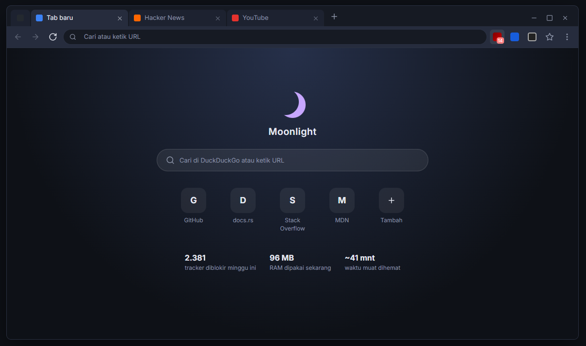
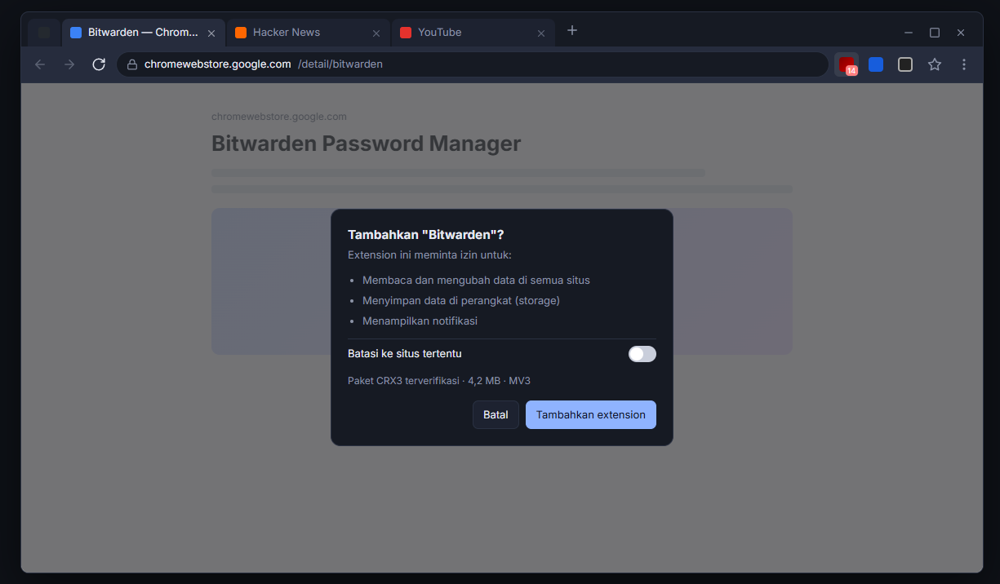

# Moonlight — Design & UI Spec

Last updated: 2026-11-23

Related documents: [Product Requirements](01-product-requirements.md)

## Design principles

The Moonlight mockups show a browser that is dark, calm, and open about what happens inside it; the four principles below guide every screen that is not designed yet.

1. **Content first.** The browser chrome is dark and low-contrast so the web page stays the focus.
2. **Show, don't hide.** Real numbers (requests blocked, RAM, versions, package size) appear where the user makes decisions.
3. **Honest about limits.** The Partial status and the yellow banner name what is missing instead of a generic message.
4. **One action color.** Periwinkle blue for primary actions, bright blue for active states; other colors only for status (green, orange, red, yellow).

Identity: a purple crescent moon logo, a semibold sans-serif "Moonlight" wordmark, and a faint dark-blue glow at the top of the New Tab page.

## Design tokens

The colors below were sampled from the dominant pixels of the four mockup screenshots; font sizes, radii, and spacing are visual estimates. Match them against the original design files before locking them in code.

**Colors — dark theme (browser chrome and internal pages)**

| Token | Value | Used for |
| --- | --- | --- |
| `bg.canvas` | `#0E1117` | Internal page background, bottom of New Tab |
| `bg.frame` | `#0B0D12` | Outer window frame |
| `surface.1` | `#161A23` | Tab strip, omnibox, extension cards, dialogs |
| `surface.2` | `#262C3D` | Active tab, toolbar, active sidebar item |
| `surface.3` | `#1D2230` | Secondary buttons |
| `surface.input` | `#2C3343` | New Tab search box |
| `surface.tile` | `#262B38` | New Tab shortcut tiles |
| `border.subtle` | `#2A3142` | Dividers, window outline |
| `glow.top` | `#252E47` | Radial glow at the top of New Tab |
| `text.primary` | `#E6E9F2` | Headings, body text |
| `accent.primary` | `#8FB3FF` | Primary buttons (Open Chrome Web Store, Add extension) |
| `accent.active` | `#3B82F6` | Active toggles, tab indicator, links |
| `brand.moon` | `#C7A6FF` | Crescent moon logo |
| `status.danger` | `#FF8080` (estimate) | Count badge on extension icons |

**Colors — light surfaces (web pages and the extension popup in the mockups)**

| Token | Value | Used for |
| --- | --- | --- |
| `light.surface` | `#FFFFFF` | Popup |
| `light.canvas` | `#F6F7FB` | Page background |
| `light.skeleton` | `#DFE3EE` | Content placeholders |
| `light.toggleOff` | `#C9CEDB` | Toggle off |
| `warning.bg` / `warning.fg` | `#FFF7E0` / `#E7A424` | "Unsupported by the engine" banner |
| `success.bg` | `#F0FDF6` | "Optimal" pill |

**Typography** (estimated from the mockups; looks like Inter)

| Token | Size / weight | Example |
| --- | --- | --- |
| `display` | 32 px / 700 | The "14" in the popup |
| `title.lg` | 22 px / 700 | Page title "Extensions" |
| `title.md` | 20 px / 600 | "Moonlight" wordmark on New Tab |
| `body` | 13 px / 400 | Descriptions, menu items, tab text |
| `body.strong` | 13 px / 600 | Extension names, stat numbers |
| `caption` | 12 px / 400 | Version · RAM, stat labels |
| `badge` | 11 px / 500 | Full compatibility, All sites labels |

**Shape and spacing** (estimates)

| Token | Value | Used for |
| --- | --- | --- |
| `radius.sm` | 6 px | Buttons |
| `radius.md` | 10 px | Cards, tiles, tabs |
| `radius.lg` | 12 px | Dialogs, popups |
| `radius.full` | 9999 px | Omnibox, New Tab search box, badges, toggles |
| `space` | multiples of 4 px; card padding 16 px; card grid gap 12 px | |
| `height.tabstrip` / `height.toolbar` | ≈ 40 px / ≈ 44 px | |

## Screen and component inventory

The four existing mockups cover New Tab, extension management, the install dialog, and an extension popup; together they are enough to build the Alpha extension features.

| Screen | Main content | Engineering notes |
| --- | --- | --- |
| New Tab (`moonlight://newtab`) | Logo + wordmark, "Search DuckDuckGo or type a URL" box, 4 shortcuts + Add, stats for trackers this week, RAM now, load time saved | Stats come from `ml-storage` through an internal API; RAM from process measurement |
| Extensions (`moonlight://extensions`) | Settings sidebar, title + "Manifest V3" subtitle, three install buttons, Developer mode toggle, 2-column card grid | Card: icon, name, version · RAM, description, compatibility badge, site access badge, Details link, toggle |
| Chrome Web Store install dialog | Title "Add "Bitwarden"?", permission list, "Limit to specific sites" toggle, package status, Cancel / Add extension | Modal over the CWS page with a dark scrim; focus trapped in the dialog |
| Web page + extension popup | Yellow compatibility banner, "14 blocked" shield in the omnibox, uBlock Origin Lite popup | Popup = the extension's own HTML in an H7 WebView; banner = a shell component, not injected into the page |

**Reusable components**

- Tab (active, inactive, colored favicon, close button) and the new-tab button.
- Toolbar: back, forward, reload, omnibox, extension icon area with badges, bookmark star, three-dot menu.
- Omnibox in two variants: with a URL (lock + bold domain + dimmed path + green shield) and empty (search icon + placeholder).
- Buttons: primary (periwinkle), secondary (dark), link.
- Toggle (on is blue, off is gray).
- Badges: success (green), neutral (gray), warning (orange), count (red on icons).
- Extension card, shortcut tile, stat number + label, sidebar item.
- Modal dialog and warning banner with a close button.

**Original mockups** (their copy is still in Indonesian; see the findings below)

## Design gaps

Alpha still needs 12 screens or states that are not in the mockups, plus three findings on the existing mockups.

**Screens and states to design** (ordered by Alpha need)

- [ ] Settings: General, Privacy, Appearance, Downloads, About
- [ ] Extension details (permissions, site access, missing APIs, remove button)
- [ ] Shield breakdown on click (requests blocked per domain) + per-site blocker toggle; global blocker toggle in Settings > Privacy
- [ ] History and bookmarks (pages + bookmarks bar)
- [ ] Downloads panel in the toolbar + Downloads page
- [ ] Three-dot menu and context menus (page, tab, extension icon)
- [ ] Error pages: offline, invalid certificate, crashed tab, crashed extension
- [ ] Report form from the compatibility banner
- [ ] Site info popover (click the lock) and site permission prompts
- [ ] Find bar and zoom indicator
- [ ] Tab overflow (many tabs), loading tab, tab playing audio
- [ ] Private window (visual distinction) and first-run onboarding

**Findings on the existing mockups**

1. **Mockup copy is in Indonesian:** the UI is English-only, so every mockup needs English copy (for example "New tab", "Extensions", "Developer mode", "14 blocked", "Report").
2. **The popup covers the banner link:** the extension popup covers the button at the right end of the yellow banner. Make sure the banner stays clickable or move the popup.
3. **The "Limit to specific sites" toggle** has no follow-up state: when it is turned on, the user must pick sites. A site picker needs to be designed.

The contrast of small gray text (stat labels, version · RAM) on `#161A23` must be checked against WCAG AA (minimum ratio 4.5:1) before the tokens are locked.
