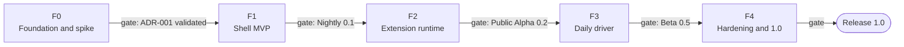

# Moonlight — Roadmap

Last updated: 2026-11-23

Related documents: [Product Requirements](01-product-requirements.md) · [Technical Architecture](02-technical-architecture.md)

## Phase order

Platforms: F0–F2 (through Alpha) are Windows only. From F3 (Beta) and in 1.0: Windows, Linux, and macOS.

There are no fixed dates: each phase starts when the previous phase's exit criteria are met. The most important gate is validating ADR-001 at the end of F0.

## Phase details and exit criteria

A phase only closes when its exit criteria are met; if not, the phase continues or P1/P2 scope is cut, never quality.

| Phase | Main outputs | Exit criteria |
| --- | --- | --- |
| **F0 — Foundation & spike** | Repo + Windows CI (F0–F2 are Windows only); Servo prototype with 1 WebView; list of 50 test sites + 20 test extensions; RAM/startup benchmarks; ADR-001 validation | ADR-001 criteria measured and met; hooks H1–H8 rated present / addable / blocker |
| **F1 — Shell MVP** | Tabs, omnibox, navigation, New Tab, basic Settings, history, bookmarks, downloads, error pages, built-in tracker blocker | Nightly 0.1 usable for light daily browsing; New Tab RAM ≤ 150 MB |
| **F2 — Extension runtime v1** | Manifest, CRX3, install from CWS/.crx/unpacked, permission dialog, action + popup, Alpha APIs from the matrix, shield, compatibility banner | Public Alpha 0.2; the 7 Alpha-target test extensions work; hook H4 (isolated world) available; fuzzing manifest/CRX/DNR for 24 hours without a crash |
| **F3 — Daily driver** | 1.0-phase APIs, private window, session restore, site permissions, DevTools, print/PDF, import, auto-update, Linux and macOS support | Beta 0.5; ≥ 12 of 20 test extensions work; ≥ 80% of test sites pass |
| **F4 — Hardening & 1.0** | Separate content processes, external security audit, accessibility audit, performance work | Every success metric in the PRD is met; no open critical security bugs |

## How we work: solo + AI

Moonlight is built solo with AI assistance and no fixed schedule; quality comes from tests, CI, and manual review of security-sensitive code.

1. Split work into small tasks that fit in one session, one branch per task.
2. Ask the AI to write tests together with the code; code without tests is not merged.
3. CI must be green before merging into `main`.
4. Read security-sensitive code yourself: CRX verification, `PermissionGate`, the JS ↔ Rust bridge, the updater, and the manifest and DNR rule parsers.
5. Record big decisions as ADRs so the next AI session has the same context.
6. Keep project conventions in an AI instruction file at the repo root (`AGENTS.md`) so every AI session follows the same rules.
7. Nightly builds run automatically every night; upgrade Servo every month to follow upstream releases.
